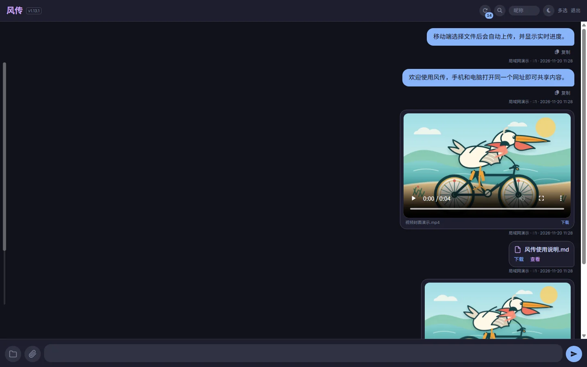
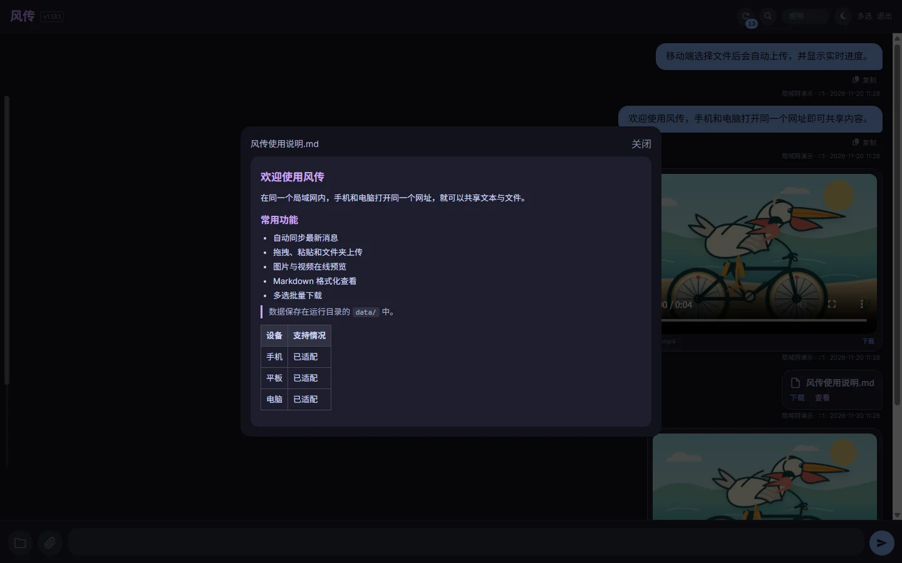
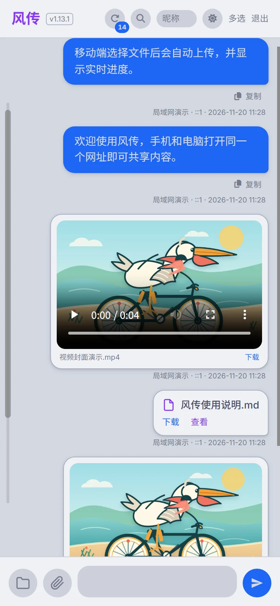
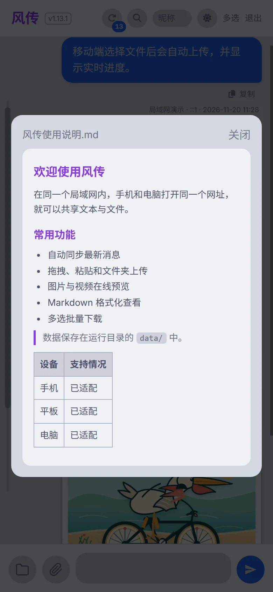

<div align="center">
  
  <h1>风传 · FengChuan</h1>
  <p>局域网多设备剪贴板、文本与文件快传工具。</p>

  <a href="https://github.com/dafile/fengchuan/releases/latest"></a>
  <a href="https://github.com/dafile/fengchuan/actions/workflows/ci.yml"></a>
  <a href="LICENSE"></a>
</div>

---

风传是一个面向局域网的自托管 Web 应用。部署在一台电脑或服务器上后，同一网络中的手机、平板和其他电脑可以通过浏览器直接互传文本、文件和文件夹，无需安装客户端。

它适合临时剪贴板、跨设备消息同步、局域网文件快传、课堂资料分发和私人轻量文件中转。

## 界面预览

| 电脑端 | 电脑端 Markdown |
| --- | --- |
|  |  |

| 移动端 | 移动端 Markdown |
| --- | --- |
|  |  |

## 功能

- 所有设备打开同一网址，共享同一条持久化消息流
- 文本消息自动同步、手动复制和自动复制提示
- 多文件上传、文件夹整体打包为 ZIP、拖拽上传和粘贴上传
- 移动端选择文件后自动上传
- 文件上传实时进度、整体百分比、大小和失败状态
- 图片、视频、音频、文本及常见文件在线预览
- 服务端通过 FFmpeg 提取并缓存视频首帧，移动端不再显示黑屏封面
- Markdown 文件格式化为标题、列表、代码块、表格和引用
- Markdown 渲染会隔离原始 HTML 和危险链接
- 消息搜索、关键词高亮和阅读位置保持
- 15 秒循环自动刷新，切回页面后立即刷新
- 密码登录、可配置会话有效期和一年保持登录
- 多选批量下载、ZIP 打包下载
- 访问记录独立页面，记录永久保存在本地
- 自动、亮色、暗色主题切换
- 移动端与桌面端响应式布局
- PWA 元数据与离线静态资源

## 快速开始

### Windows 便携版

从 [Releases](https://github.com/dafile/fengchuan/releases/latest) 下载最新的 Windows x64 压缩包，解压后运行 `启动风传.bat`。

默认监听 `8099` 端口。在同网段设备中打开：

```text
http://<运行风传的电脑IP>:8099/
```

### 从源码构建

需要 Go 1.23 或更高版本：

```bash
git clone https://github.com/dafile/fengchuan.git
cd fengchuan
go build -trimpath -ldflags="-s -w" -o fengchuan .
```

运行：

```bash
./fengchuan -listen :8099 -password "请替换为你的密码" -session-ttl 10m
```

Windows 示例：

```powershell
.\fengchuan.exe -listen :8099 -password "请替换为你的密码" -session-ttl 10m
```

### Docker

```bash
docker build -t fengchuan .
docker run --name fengchuan \
  -p 8099:8080 \
  -v fengchuan-data:/app/data \
  fengchuan -listen :8080 -password "请替换为你的密码"
```

## 视频封面

视频首帧封面由 FFmpeg 生成并缓存在 `data/thumbs/`。

- Windows 便携包已内置 `ffmpeg.exe`
- 源码运行时可把 `ffmpeg` 放入程序目录或系统 `PATH`
- 找不到 FFmpeg 或提取失败时，会显示播放占位图而不是黑屏

## 配置参数

| 参数 | 默认值 | 说明 |
| --- | --- | --- |
| `-listen` | `:8080` | HTTP 监听地址和端口 |
| `-password` | 需设置 | Web 登录密码，公开部署前必须修改 |
| `-session-ttl` | `10m` | 普通登录会话有效期 |

## 数据目录

运行目录下的 `data/` 保存所有业务数据：

- `data/text/`：文本消息
- `data/files/`：上传文件
- `data/thumbs/`：视频封面缓存
- `data/access-log.jsonl`：访问记录
- `data/settings.json`：站点设置

升级程序时不要删除或覆盖 `data/`。项目不依赖外部数据库，备份 `data/` 即可保存全部内容。

## 安全说明

- 风传默认面向可信局域网使用，不内置 TLS。
- 不要直接暴露到公网；如需远程访问，请放在带 HTTPS 和额外认证的反向代理后面。
- 首次部署必须通过启动参数设置强密码。
- Markdown 查看器会转义原始 HTML，但仍建议只向可信用户开放上传权限。

## 项目来源

风传最初基于 [Tanq16/local-content-share](https://github.com/Tanq16/local-content-share) 的 MIT 许可代码进行重构与扩展，当前已发展为独立的中文局域网快传与共享剪贴板应用。

## License

本项目沿用 MIT License，详见 [LICENSE](LICENSE)。

分发包中的 FFmpeg 属于独立第三方组件，其许可信息随发行包一并提供。
